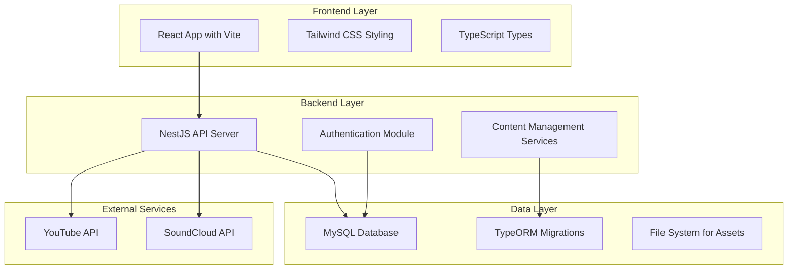

# Design Document: Coreysmaller.com Personal Website

## Overview

Coreysmaller.com is a modern personal website built with React, TypeScript, Vite, and Tailwind CSS on the frontend, and NestJS with TypeORM and MySQL on the backend. The system provides a comprehensive content management platform for blog posts, music portfolio, video content, and audio integration, with a secure admin panel for content management.

The architecture follows a clean separation between frontend presentation, backend API services, and data persistence layers. The system supports content migration from existing markdown files and provides modern web development practices including SEO optimization, responsive design, and performance optimization.

## Architecture

### System Architecture



### Component Architecture

The frontend follows a component-based architecture with clear separation of concerns:

- **Pages**: Route-level components (Home, Blog, Music, Video, Audio, Admin)
- **Components**: Reusable UI components (Header, Navigation, ContentCard, Player)
- **Services**: API communication layer
- **Hooks**: Custom React hooks for state management
- **Types**: TypeScript interfaces and types
- **Utils**: Helper functions and utilities

The backend follows NestJS modular architecture:

- **Modules**: Feature-based modules (Auth, Blog, Music, Video, Audio)
- **Controllers**: HTTP request handlers
- **Services**: Business logic implementation
- **Entities**: TypeORM database entities
- **DTOs**: Data transfer objects for validation
- **Guards**: Authentication and authorization
- **Interceptors**: Request/response transformation

## Components and Interfaces

### Frontend Components

#### Core Page Components

**HomeComponent**
```typescript
interface HomeProps {
  recentPosts: BlogPost[];
  featuredMusic: MusicTrack[];
  latestVideos: VideoContent[];
}

class HomeComponent {
  render(): JSX.Element;
  loadRecentContent(): Promise<void>;
}
```

**BlogComponent**
```typescript
interface BlogProps {
  posts: BlogPost[];
  pagination: PaginationInfo;
}

class BlogComponent {
  render(): JSX.Element;
  loadPosts(page: number): Promise<void>;
  searchPosts(query: string): Promise<void>;
}
```

**MusicComponent**
```typescript
interface MusicProps {
  tracks: MusicTrack[];
  categories: string[];
}

class MusicComponent {
  render(): JSX.Element;
  playTrack(trackId: string): void;
  filterByCategory(category: string): void;
}
```

**AdminComponent**
```typescript
interface AdminProps {
  isAuthenticated: boolean;
  currentUser: User;
}

class AdminComponent {
  render(): JSX.Element;
  handleLogin(credentials: LoginCredentials): Promise<void>;
  handleLogout(): void;
}
```

#### Shared Components

**NavigationComponent**
```typescript
interface NavigationProps {
  currentPath: string;
  isAuthenticated: boolean;
}

class NavigationComponent {
  render(): JSX.Element;
  handleNavigation(path: string): void;
}
```

**ContentCardComponent**
```typescript
interface ContentCardProps {
  title: string;
  description: string;
  imageUrl?: string;
  publishDate: Date;
  contentType: 'blog' | 'music' | 'video' | 'audio';
}

class ContentCardComponent {
  render(): JSX.Element;
}
```

### Backend Services

#### Authentication Service

```typescript
interface AuthService {
  validateUser(email: string, password: string): Promise<User | null>;
  login(user: User): Promise<{ access_token: string }>;
  validateToken(token: string): Promise<User | null>;
}

class AuthService {
  async validateUser(email: string, password: string): Promise<User | null>;
  async login(user: User): Promise<{ access_token: string }>;
  async validateToken(token: string): Promise<User | null>;
}
```

#### Content Management Services

**BlogService**
```typescript
interface BlogService {
  createPost(postData: CreateBlogPostDto): Promise<BlogPost>;
  getAllPosts(pagination: PaginationDto): Promise<BlogPost[]>;
  getPostById(id: string): Promise<BlogPost>;
  updatePost(id: string, updateData: UpdateBlogPostDto): Promise<BlogPost>;
  deletePost(id: string): Promise<void>;
  migrateMarkdownFiles(): Promise<void>;
}

class BlogService {
  async createPost(postData: CreateBlogPostDto): Promise<BlogPost>;
  async getAllPosts(pagination: PaginationDto): Promise<BlogPost[]>;
  async getPostById(id: string): Promise<BlogPost>;
  async updatePost(id: string, updateData: UpdateBlogPostDto): Promise<BlogPost>;
  async deletePost(id: string): Promise<void>;
  async migrateMarkdownFiles(): Promise<void>;
}
```

**MusicService**
```typescript
interface MusicService {
  createTrack(trackData: CreateMusicTrackDto): Promise<MusicTrack>;
  getAllTracks(): Promise<MusicTrack[]>;
  getTrackById(id: string): Promise<MusicTrack>;
  updateTrack(id: string, updateData: UpdateMusicTrackDto): Promise<MusicTrack>;
  deleteTrack(id: string): Promise<void>;
}

class MusicService {
  async createTrack(trackData: CreateMusicTrackDto): Promise<MusicTrack>;
  async getAllTracks(): Promise<MusicTrack[]>;
  async getTrackById(id: string): Promise<MusicTrack>;
  async updateTrack(id: string, updateData: UpdateMusicTrackDto): Promise<MusicTrack>;
  async deleteTrack(id: string): Promise<void>;
}
```

### API Interfaces

#### REST Endpoints

**Authentication Endpoints**
- `POST /auth/login` - User authentication
- `POST /auth/logout` - User logout
- `GET /auth/profile` - Get current user profile

**Blog Endpoints**
- `GET /blog` - Get all blog posts with pagination
- `GET /blog/:id` - Get specific blog post
- `POST /blog` - Create new blog post (admin only)
- `PUT /blog/:id` - Update blog post (admin only)
- `DELETE /blog/:id` - Delete blog post (admin only)
- `POST /blog/migrate` - Migrate markdown files (admin only)

**Music Endpoints**
- `GET /music` - Get all music tracks
- `GET /music/:id` - Get specific music track
- `POST /music` - Create new music track (admin only)
- `PUT /music/:id` - Update music track (admin only)
- `DELETE /music/:id` - Delete music track (admin only)

**Video Endpoints**
- `GET /video` - Get all videos
- `GET /video/:id` - Get specific video
- `POST /video` - Create new video entry (admin only)
- `PUT /video/:id` - Update video entry (admin only)
- `DELETE /video/:id` - Delete video entry (admin only)

**Audio Endpoints**
- `GET /audio` - Get all audio content
- `GET /audio/:id` - Get specific audio content
- `POST /audio` - Create new audio entry (admin only)
- `PUT /audio/:id` - Update audio entry (admin only)
- `DELETE /audio/:id` - Delete audio entry (admin only)

## Data Models

### Database Entities

#### User Entity
```typescript
@Entity('users')
class User {
  @PrimaryGeneratedColumn('uuid')
  id: string;

  @Column({ unique: true })
  email: string;

  @Column()
  password: string;

  @Column({ default: 'admin' })
  role: string;

  @CreateDateColumn()
  createdAt: Date;

  @UpdateDateColumn()
  updatedAt: Date;
}
```

#### Blog Entity
```typescript
@Entity('blog')
class BlogPost {
  @PrimaryGeneratedColumn('uuid')
  id: string;

  @Column()
  title: string;

  @Column('text')
  content: string;

  @Column({ nullable: true })
  excerpt: string;

  @Column({ nullable: true })
  featuredImage: string;

  @Column('simple-array', { nullable: true })
  tags: string[];

  @Column({ default: 'published' })
  status: 'draft' | 'published' | 'archived';

  @Column({ nullable: true })
  slug: string;

  @CreateDateColumn()
  createdAt: Date;

  @UpdateDateColumn()
  updatedAt: Date;

  @Column({ nullable: true })
  publishedAt: Date;
}
```

#### Music Entity
```typescript
@Entity('music')
class MusicTrack {
  @PrimaryGeneratedColumn('uuid')
  id: string;

  @Column()
  title: string;

  @Column('text', { nullable: true })
  description: string;

  @Column({ nullable: true })
  audioUrl: string;

  @Column({ nullable: true })
  coverArt: string;

  @Column({ nullable: true })
  genre: string;

  @Column({ nullable: true })
  duration: number;

  @Column({ default: 0 })
  playCount: number;

  @CreateDateColumn()
  createdAt: Date;

  @UpdateDateColumn()
  updatedAt: Date;

  @Column({ nullable: true })
  releaseDate: Date;
}
```

#### Video Entity
```typescript
@Entity('video')
class VideoContent {
  @PrimaryGeneratedColumn('uuid')
  id: string;

  @Column()
  title: string;

  @Column('text', { nullable: true })
  description: string;

  @Column()
  youtubeUrl: string;

  @Column({ nullable: true })
  youtubeId: string;

  @Column({ nullable: true })
  thumbnail: string;

  @Column({ nullable: true })
  duration: number;

  @Column({ default: 0 })
  viewCount: number;

  @CreateDateColumn()
  createdAt: Date;

  @UpdateDateColumn()
  updatedAt: Date;
}
```

#### Audio Entity
```typescript
@Entity('audio')
class AudioContent {
  @PrimaryGeneratedColumn('uuid')
  id: string;

  @Column()
  title: string;

  @Column('text', { nullable: true })
  description: string;

  @Column()
  soundcloudUrl: string;

  @Column({ nullable: true })
  soundcloudId: string;

  @Column({ nullable: true })
  artwork: string;

  @Column({ nullable: true })
  duration: number;

  @Column({ default: 0 })
  playCount: number;

  @CreateDateColumn()
  createdAt: Date;

  @UpdateDateColumn()
  updatedAt: Date;
}
```

### Data Transfer Objects

#### Authentication DTOs
```typescript
class LoginDto {
  @IsEmail()
  email: string;

  @IsString()
  @MinLength(6)
  password: string;
}

class CreateUserDto {
  @IsEmail()
  email: string;

  @IsString()
  @MinLength(6)
  password: string;

  @IsOptional()
  @IsString()
  role?: string;
}
```

#### Blog DTOs
```typescript
class CreateBlogPostDto {
  @IsString()
  @IsNotEmpty()
  title: string;

  @IsString()
  @IsNotEmpty()
  content: string;

  @IsOptional()
  @IsString()
  excerpt?: string;

  @IsOptional()
  @IsString()
  featuredImage?: string;

  @IsOptional()
  @IsArray()
  tags?: string[];

  @IsOptional()
  @IsEnum(['draft', 'published', 'archived'])
  status?: 'draft' | 'published' | 'archived';
}

class UpdateBlogPostDto extends PartialType(CreateBlogPostDto) {}
```

#### Music DTOs
```typescript
class CreateMusicTrackDto {
  @IsString()
  @IsNotEmpty()
  title: string;

  @IsOptional()
  @IsString()
  description?: string;

  @IsOptional()
  @IsUrl()
  audioUrl?: string;

  @IsOptional()
  @IsString()
  coverArt?: string;

  @IsOptional()
  @IsString()
  genre?: string;

  @IsOptional()
  @IsNumber()
  duration?: number;
}

class UpdateMusicTrackDto extends PartialType(CreateMusicTrackDto) {}
```

## Correctness Properties

*A property is a characteristic or behavior that should hold true across all valid executions of a system-essentially, a formal statement about what the system should do. Properties serve as the bridge between human-readable specifications and machine-verifiable correctness guarantees.*

### Property Reflection

After analyzing all acceptance criteria, several properties can be consolidated to eliminate redundancy:

- CRUD operations for different content types (blog, music, video, audio) follow the same patterns and can be tested with a unified approach
- Data persistence properties are similar across all content types
- URL validation properties for YouTube and SoundCloud can be generalized
- Metadata extraction properties follow similar patterns for different external services

### Core Properties

**Property 1: Content persistence round-trip**
*For any* valid content item (blog post, music track, video, or audio), storing it in the database and then retrieving it should return equivalent data with all required fields preserved
**Validates: Requirements 1.1, 2.1, 8.3**

**Property 2: CRUD operation completeness**
*For any* content type and any valid content item, the system should support create, read, update, and delete operations that maintain data integrity
**Validates: Requirements 7.1, 7.2, 7.3, 7.4**

**Property 3: Input validation consistency**
*For any* content creation or update operation, invalid input data should be rejected with appropriate error messages, while valid input should be accepted and processed
**Validates: Requirements 1.2, 2.2, 7.5, 9.2**

**Property 4: Timestamp preservation during updates**
*For any* existing content item, updating its data should preserve the original creation timestamp while updating the modification timestamp
**Validates: Requirements 1.3, 2.3**

**Property 5: Content deletion behavior**
*For any* content item, after deletion, it should no longer be accessible through public endpoints while maintaining referential integrity
**Validates: Requirements 1.4**

**Property 6: Rich text format preservation**
*For any* blog post with rich text formatting, the content should maintain its formatting through save and load cycles
**Validates: Requirements 1.5**

**Property 7: Chronological ordering consistency**
*For any* collection of blog posts, they should always be returned in chronological order with newest first
**Validates: Requirements 1.6**

**Property 8: Audio format support**
*For any* supported audio format (MP3, WAV, streaming links), the music system should accept and properly handle the content
**Validates: Requirements 2.4**

**Property 9: Content categorization and sorting**
*For any* music tracks with categories or dates, the system should correctly organize and sort them by the specified criteria
**Validates: Requirements 2.6, 3.5**

**Property 10: URL validation for external services**
*For any* YouTube or SoundCloud URL, the system should validate the format and reject invalid URLs while accepting valid ones
**Validates: Requirements 3.2, 4.2**

**Property 11: External metadata extraction**
*For any* valid external service URL (YouTube, SoundCloud), the system should successfully extract and store relevant metadata
**Validates: Requirements 3.3, 4.3**

**Property 12: Authentication credential validation**
*For any* login attempt, the system should validate credentials against the user database and grant access only for valid email/password combinations
**Validates: Requirements 6.1, 6.2**

**Property 13: Security behavior for invalid credentials**
*For any* invalid login attempt, the system should reject access, log the attempt, and not reveal information about valid usernames
**Validates: Requirements 6.3**

**Property 14: Session management integrity**
*For any* authenticated session, the system should maintain session state within timeout periods and properly clean up expired sessions
**Validates: Requirements 6.4, 6.5**

**Property 15: Password security implementation**
*For any* user password, it should be hashed before storage and never stored or transmitted in plain text
**Validates: Requirements 6.6**

**Property 16: Database transaction atomicity**
*For any* complex operation involving multiple database changes, either all changes should succeed or all should be rolled back
**Validates: Requirements 8.5**

**Property 17: API serialization round-trip**
*For any* data model, serializing to JSON and deserializing back should produce equivalent objects
**Validates: Requirements 9.4**

**Property 18: Responsive design consistency**
*For any* page and any screen size (desktop, tablet, mobile), the layout should remain functional and accessible
**Validates: Requirements 5.4**

**Property 19: SEO metadata completeness**
*For any* page, appropriate SEO metadata should be generated and included in the HTML output
**Validates: Requirements 5.5, 10.2, 10.5**

**Property 20: Markdown migration completeness**
*For any* markdown file in the content->blog directory, it should be successfully converted to a database record with preserved metadata
**Validates: Requirements 11.2, 11.3, 11.4, 11.5, 11.6**

**Property 21: Technology stack cleanup**
*For any* Gatsby-related dependency or configuration, it should be completely removed while maintaining all existing functionality
**Validates: Requirements 12.4, 12.5, 12.6**

**Property 22: Content aggregation accuracy**
*For any* home page load, recent content from all sections should be accurately retrieved and displayed
**Validates: Requirements 5.2**

**Property 23: Navigation consistency**
*For any* page navigation, header and navigation elements should remain consistent and functional
**Validates: Requirements 5.3**

**Property 24: Error handling descriptiveness**
*For any* error condition, the system should provide descriptive error messages and appropriate HTTP status codes
**Validates: Requirements 9.3**

**Property 25: Performance optimization effectiveness**
*For any* page load, code splitting and lazy loading should reduce initial bundle size and improve load times
**Validates: Requirements 10.1**

**Property 26: Caching strategy effectiveness**
*For any* frequently accessed data, caching should reduce database queries and improve response times
**Validates: Requirements 10.3**

## Error Handling

### Frontend Error Handling

The frontend application implements comprehensive error handling:

- **Network Errors**: API communication failures are caught and displayed with user-friendly messages
- **Validation Errors**: Form validation errors are displayed inline with specific field feedback
- **Authentication Errors**: Login failures and session expiration are handled with appropriate redirects
- **Content Loading Errors**: Failed content loads show fallback UI with retry options
- **Route Errors**: Invalid routes display 404 pages with navigation back to valid content

### Backend Error Handling

The backend API implements structured error handling:

- **Validation Errors**: Input validation failures return 400 Bad Request with detailed field errors
- **Authentication Errors**: Invalid credentials return 401 Unauthorized with security logging
- **Authorization Errors**: Insufficient permissions return 403 Forbidden
- **Resource Errors**: Missing resources return 404 Not Found
- **Server Errors**: Internal errors return 500 Internal Server Error with error logging
- **Database Errors**: Connection and query failures are logged and return appropriate error responses

### Error Logging and Monitoring

- All errors are logged with appropriate severity levels
- Security-related errors (failed logins, unauthorized access) are logged with additional detail
- Database errors include query information for debugging
- Frontend errors are captured and can be reported to monitoring services
- Error logs include timestamps, user context, and request information

## Testing Strategy

### Dual Testing Approach

The testing strategy employs both unit testing and property-based testing as complementary approaches:

**Unit Testing Focus:**
- Specific examples and edge cases for individual components
- Integration points between frontend and backend
- Error conditions and boundary cases
- Authentication and authorization flows
- External service integration points

**Property-Based Testing Focus:**
- Universal properties that hold across all valid inputs
- Data integrity and consistency properties
- CRUD operation correctness across content types
- Input validation behavior across different data types
- Performance and security properties

### Property-Based Testing Configuration

- **Testing Library**: Use `fast-check` for TypeScript/JavaScript property-based testing
- **Test Iterations**: Minimum 100 iterations per property test to ensure comprehensive coverage
- **Test Tagging**: Each property test must reference its design document property with the format:
  - **Feature: coreysmaller-website, Property {number}: {property_text}**
- **Generator Strategy**: Custom generators for domain objects (BlogPost, MusicTrack, etc.)
- **Shrinking Strategy**: Implement custom shrinking for complex domain objects

### Unit Testing Balance

Unit tests complement property tests by focusing on:
- Specific user workflows and integration scenarios
- Edge cases that are difficult to generate randomly
- Error conditions and exception handling
- UI component behavior and user interactions
- External API integration and mocking

### Testing Implementation Requirements

- Each correctness property must be implemented by a single property-based test
- Property tests should generate diverse, realistic test data
- Unit tests should cover specific examples that demonstrate correct behavior
- Integration tests should verify end-to-end workflows
- All tests should be automated and run in CI/CD pipeline

### Performance Testing

- Load testing for API endpoints under concurrent access
- Frontend performance testing with Lighthouse CI
- Database query performance testing with realistic data volumes
- Memory usage testing for large content collections
- Network performance testing for external service integrations